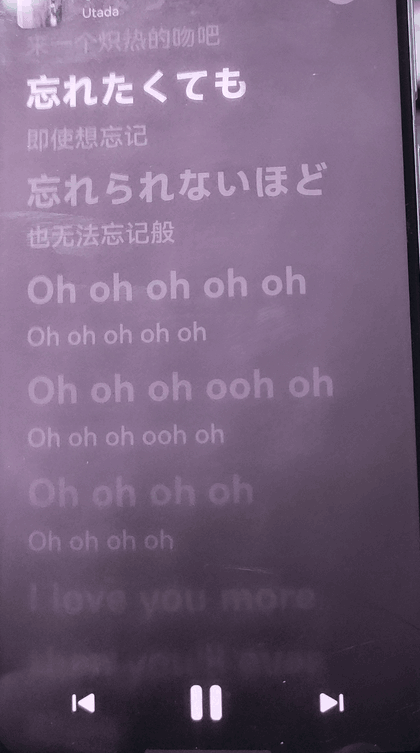
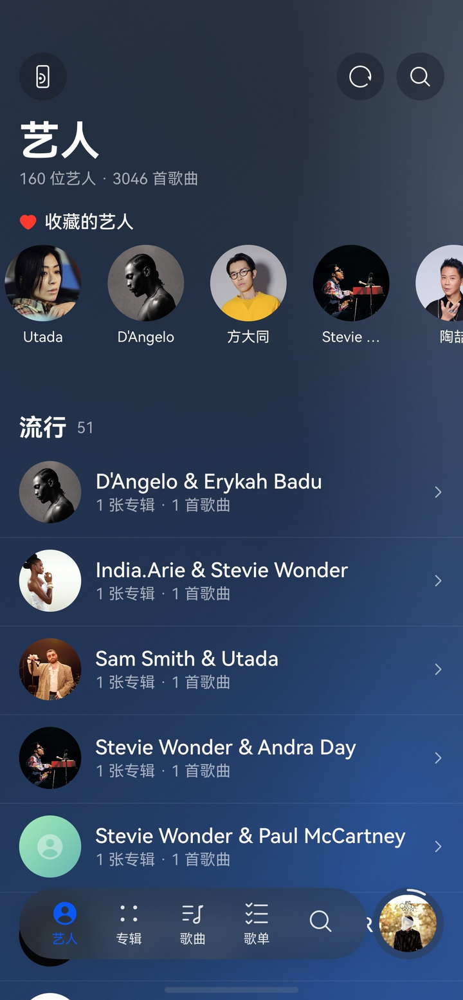
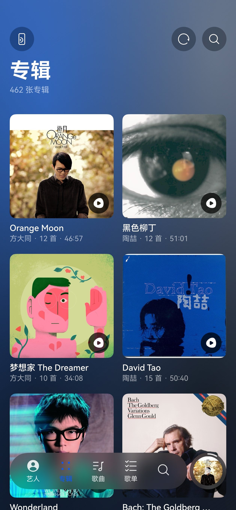
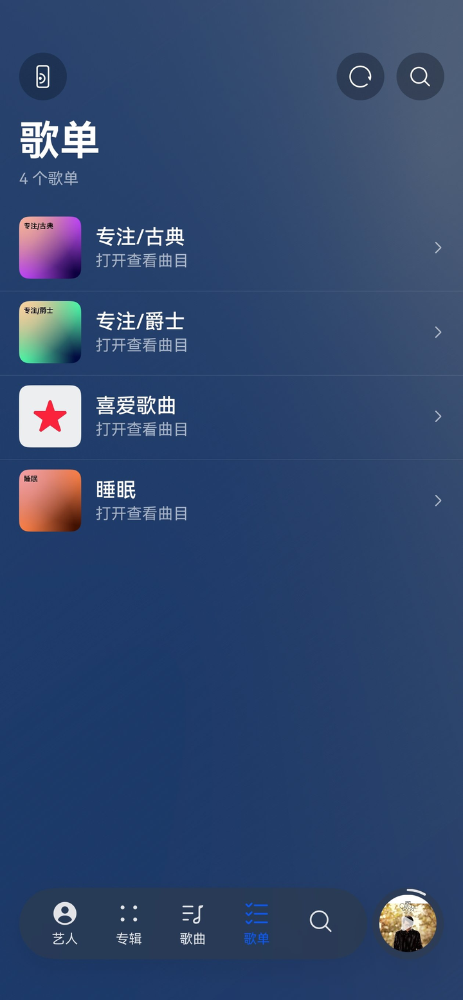
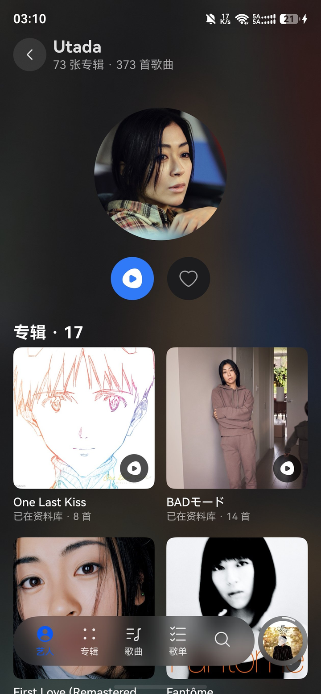
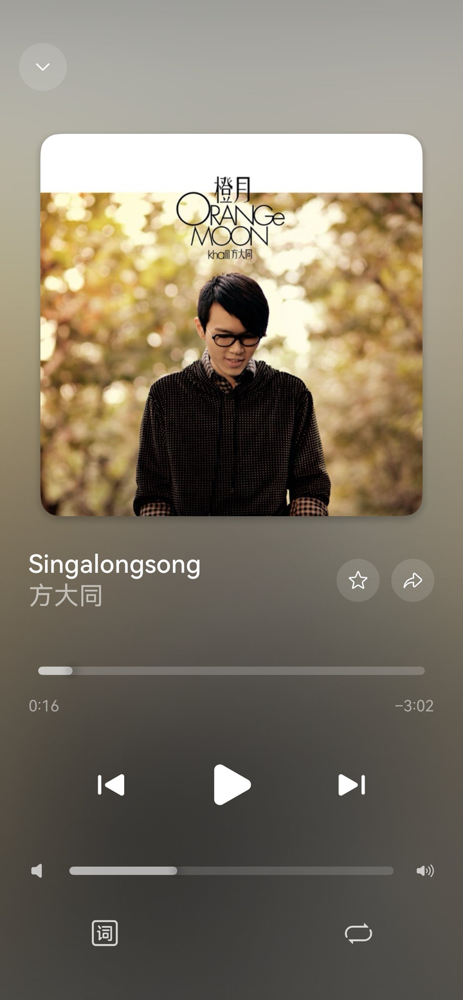
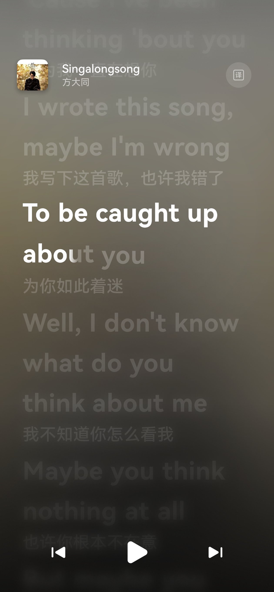
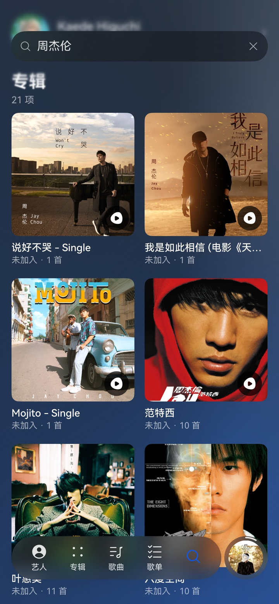

# musichome · 在鸿蒙上听 Apple Music

> 一个**个人自用**的 HarmonyOS NEXT（ArkTS / ArkUI V2）Apple Music 客户端。
> 完整实现了「登录 → 资料库同步 → 在线取流 → Widevine L3 解密 → 系统播放器播放」这一整条链路，
> 以及一套逐字跟唱的歌词动效。
>
> **先说清楚：这个软件目前很简陋。** 只有 Apple Music 的资料库（艺人 / 专辑 / 歌曲 / 歌单），
> 没有推荐页、没有在线目录的完整浏览；还会有 bug；界面上很多交互（长按拖动排序、抽屉手势、
> 播放条展开方式）都是按**我自己**的使用习惯做的，对别人来说可能别扭。
>
> **这正是它全部开源的原因**：你不需要迁就我的取舍，拿去改成你要的样子。

---

## 目录

- [它解决什么问题](#它解决什么问题)
- [核心：鸿蒙上怎么听 Apple Music](#核心鸿蒙上怎么听-apple-music)
- [我比较得意的：歌词效果](#我比较得意的歌词效果)
- [界面](#界面)
- [代码地图（想改的话从这里进）](#代码地图想改的话从这里进)
- [直接装（预编译包）](#直接装预编译包)
- [使用指南](#使用指南)
- [构建](#构建)
- [仓库结构](#仓库结构)
- [已知问题与边界](#已知问题与边界)
- [许可与声明](#许可与声明)

---

## 它解决什么问题

鸿蒙设备上一直没有 Apple Music：

- 没有官方鸿蒙版；
- 鸿蒙 NEXT 不能直接装 Android APK。用「卓易通」这类安卓兼容层确实能把安卓版 Apple Music 装上，
  但**音量不跟系统走、性能也明显打折**（作者实测），当不了日常播放器；
- 网页版在 HarmonyOS 里**放不出声音** —— 网页播放依赖 EME，而鸿蒙 ArkWeb 只有
  `com.wiseplay.drm` 与 ClearKey，**没有 Widevine / PlayReady / FairPlay**（实测）。

所以「在鸿蒙上正常听自己的 Apple Music 资料库」这件事，必须自己把 DRM 那一段补上。
这个项目就是那条路的一次完整走通：**用 Widevine L3 的软件 CDM（WVD）在应用内解密，
再把明文音频交给系统 AVPlayer 播放。**

> ⚠️ 这意味着它绕过了 Apple 的 DRM。只有「你自己付费订阅的账号、你自己的设备、你自己听」才谈得上合理；
> 分发音频、商用、做成在线服务都是另一回事。仓库不附带任何凭据，WVD 需要你自己准备。

## 核心：鸿蒙上怎么听 Apple Music

整条链路（细节见 [`docs/技术实现-AppleMusic音源.md`](docs/技术实现-AppleMusic音源.md)）：

```
① 登录      内嵌 ArkWeb 打开 music.apple.com（Apple 官方页面，密码只交给 Apple）
            → 从 cookie 取 media-user-token（音乐身份票据，不含密码）
            → 存 Preferences；顺手抓页面里的开发者 token（AMPWebPlay 的 JWT）

② 资料库    amp-api.music.apple.com
            /v1/me/library/{songs,albums,artists,playlists}（每页 100，6 页并发）
            → 批量写 RDB（400 行一批，2888 首 ≈ 0.8s）
            → 收藏状态用 ?extend=inFavorites

③ 取流      /v1/me/library/songs/{i.xxx} → webPlayback → HLS m3u8
            → 解析 #EXT-X-BYTERANGE，4 路并发拉分片（实测 2.2× 提速）

④ 解密      WVD → 本地 CDM：challenge ↔ Apple license 换内容密钥（AES-128）
            → CENC 逐 sample 解密
            → **删掉 moov 里的 pssh**（不删 AVPlayer 会等一个永远不来的许可证，永不 prepare）
            → 密钥只转一次 + cipher 对象池 + 8 路并发（4629ms → 339ms，13.6×）

⑤ 播放      明文 m4a 落沙箱 → fdSrc 交给 AVPlayer
            → AVSession 接播控中心 / 锁屏；应用级单例，页面销毁不打断播放
```

几个踩过的硬坑（文档里都有）：license 必须用 `webPlayback` 返回的 **catalog 数字 id**；
HLS 分片 `@offset` 省略时要「接着上一段」；`senc` 的 IV 长度不能写死 16 字节；
并发下载同一首要用 single-flight + 原子写，否则半截文件会被永久缓存命中。

## 我比较得意的：歌词效果

（细节见 [`docs/歌词效果实现.md`](docs/歌词效果实现.md)）



> 上面这段是**真机实拍**（手机录屏后逐帧摆正、压成 GIF）。想看清细节可以看
> [逐帧校正后的 MP4](docs/media/lyrics-demo.mp4)（720×1290，7.6 秒）。

- **逐字填充**：每个字有自己的时间窗，白字层按实测宽度从左往右长出来，字与字首尾相接，填满瞬间轻弹一下。
- **柔和边缘**：ArkUI 没有 alpha 渐变遮罩，用「多层同内容、宽度递增、透明度 `1/j` 递减」逼近 ——
  这个 `1/j` 是按叠加公式**反解**出来的，凭感觉调一定出现一条硬线。
- **自持位置滚动**：不用 `List.scrollTo`（会忽快忽慢），改成 `translateY` 自己持有位置，
  换行时下一发弹簧动画；动画被打断会从当前渲染值继续，结构上不可能「找补」。
- **景深**：只给离焦点近的几行加模糊，其余靠透明度压暗 —— 逐项 `blur()` 是渲染最贵的属性。
- 中文/日文/英文按「汉字一字、拉丁整词」切分；译文单独一行，字号与透明度分层。

## 界面

五个板块（艺人 / 专辑 / 歌曲 / 歌单）+ 一个全局搜索按钮，底部是 HDS 悬浮页签栏，右下角那颗圆封面是播放条
（左滑展开成全屏播放页）。下面都是真机截图：

<table>
<tr>
<td align="center"><br><sub><b>艺人</b>：收藏的艺人横排（可长按拖动排序）+ 按流派分组</sub></td>
<td align="center"><br><sub><b>专辑</b>：资料库全部专辑；收藏的会置顶并与列表去重</sub></td>
<td align="center"><br><sub><b>歌单</b>：Apple 资料库里的自建歌单</sub></td>
</tr>
<tr>
<td align="center"><br><sub><b>艺人详情</b>：头像 + 一键随机播放 + 收藏 + 专辑网格</sub></td>
<td align="center"><br><sub><b>全屏播放页</b>：封面从播放条那颗「生长」上来</sub></td>
<td align="center"><br><sub><b>歌词页</b>：只有当前行是白的，其余压暗</sub></td>
</tr>
<tr>
<td align="center"></td>
<td align="center"><br><sub><b>搜索</b>：只搜本机资料库；未加入资料库的专辑也能点开就听</sub></td>
<td align="center"></td>
</tr>
</table>

## 代码地图（想改的话从这里进）

完整版见 [`docs/板块与代码结构.md`](docs/板块与代码结构.md)（含「想改某处该动哪个文件」的对照表与踩坑清单）。最小版：

| 板块 | 首页 | 数据来源 |
|---|---|---|
| 艺人 | `features/library/.../view/ArtistsPage.ets` → `ArtistDetailPage.ets` | `/v1/me/library/artists` + 资料库歌曲聚合 |
| 专辑 | `AlbumsPage.ets` → `AlbumDetailPage.ets` | `/v1/me/library/albums`（未入库的走目录接口） |
| 歌曲 | `AllSongsPage.ets` | `songs` 表 |
| 歌单 | `PlaylistsPage.ets` → `PlaylistDetailPage.ets` | `/v1/me/library/playlists` |
| 搜索 | `SearchPage.ets` | 本机内存镜像 + 目录 API |

播放层不在任何 tab 里：`features/player/.../view/Player.ets`（底部播放条）→ `PhonePlaybackPage.ets`（全屏页）
→ `AppleLyricsView.ets`（歌词），核心是 `model/MediaService.ets`（应用级单例）。
外壳在 `products/default/.../pages/Index.ets`：5 个页签 + **每个 tab 一条独立导航栈** + 唯一的背景流光层。

**新增一个板块需要动 4 处**：`Index.ets` 加 `TabContent`、新建页面（根节点是 `HdsNavDestination`）、
`router_map.json` 注册路由、给这个 tab 一条自己的 `NavPathStack`。

## 直接装（预编译包）

不想自己编译的话，仓库里带了一份**预编译的未签名包**：

[`dist/musichome-1.0.0-public-unsigned.hap`](dist/musichome-1.0.0-public-unsigned.hap)
（约 1.6 MB，release 构建；1.0.0 / `com.sample.musichome`，**要求 API 26 / HarmonyOS 7 及以上**）

鸿蒙装应用**必须签名**，而签名和华为账号、设备绑定 —— 别人签的包装不到你手机上，这一步只能自己做：

**A. 用 DevEco 直接装（最省事）**

1. clone 本仓库，DevEco Studio 打开工程；
2. `Project Structure → Signing Configs` → 勾「Automatically generate signature」（要登录华为账号）；
3. 手机开「开发者模式 + USB 调试」，点运行。

**B. 只装现成包（给 HAP 重新签名）**

证书 / Profile 用你自己在 DevEco 里生成的那一套（`Build → Generate Key and CSR` 得到的
`*.p12` / `*.cer` / `*.p7b`，一般在 `~/.ohos/config/` 下），再用 SDK 自带的签名工具重签，然后 `hdc install`：

```bash
# 路径按你的 DevEco 安装位置、以及 ~/.ohos/config 里的实际文件名替换
java -jar /Applications/DevEco-Studio.app/Contents/sdk/default/openharmony/toolchains/lib/hap-sign-tool.jar \
  sign-app -mode localSign -signAlg SHA256withECDSA \
  -keyAlias "debugKey" -keystoreFile "xxx.p12" -keystorePwd "***" -keyPwd "***" \
  -appCertFile "xxx.cer" -profileFile "xxx.p7b" \
  -inFile dist/musichome-1.0.0-public-unsigned.hap \
  -outFile musichome-signed.hap

hdc install musichome-signed.hap
```

> 用 DevEco「Automatically generate signature」时，密钥库密码由 DevEco 托管、不落明文，想重签请改用
> `Build → Generate Key and CSR` 自己建的密钥与 Profile（密码是你自己设的），或者直接走路 A。

**包里有什么、没有什么**（每次发包前 `tools/apple-music/scan-hap-secrets.py` 会自动扫一遍）：

- 有：登录 / 资料库同步 / 取流解密 / 播放 / 歌词 / 界面的完整代码与资源；
- **没有**：作者的账号、cookie、登录票据、DeepSeek API key、WVD、本机路径，
  也没有官方 sample 带进来的示例音频与示例封面；
- 所以装完是**干净的新装**：Apple Music 账号要自己登录，AI 歌词翻译要自己填 key，
  **WVD 得自己准备**（缺了它只能浏览资料库，一播放就报错）。

## 使用指南

### 0. 你需要的

| 东西 | 说明 |
|---|---|
| HarmonyOS 手机（API 26 / HarmonyOS 7 实测） | 作者设备是 Mate 60 Pro+ |
| DevEco Studio（含 API 26 SDK） | 构建用 |
| Apple Music 订阅 | 用你自己的账号登录 |
| 一份 Widevine L3 设备凭证（`.wvd`） | **仓库不附带** |
| （可选）DeepSeek API key | 想用 AI 歌词翻译才需要 |

### 1. 准备 WVD

`common/musicbasic/src/main/ets/apple/widevine/WvdLocal.example.ets` 是空模板，
复制成 `WvdLocal.ets`（已 gitignore），把 WVD 的 base64 填进 `LOCAL_WVD_BASE64`。
没有 WVD 也能编译、能浏览资料库，但**播放会失败**。

### 2. 构建

```bash
# 本地自用（带你自己的 key / WVD / 签名）
bash tools/apple-music/build.sh musichomesample

# 对外分发（release、不含凭据与示例资源、不签名）→ dist/musichome-<版本>-public-unsigned.hap
# 就是「直接装」那一节里的包；构建完会自动跑一遍凭据扫描
bash tools/apple-music/build.sh musichomesample public
```

签名：仓库不提交签名配置。用 DevEco 打开工程 → Project Structure → Signing Configs →
勾「Automatically generate signature」；命令行则把签名配置存成
`build-profile.signing.local.json5`（已 gitignore），脚本会临时套用。

### 3. 登录

首次启动是登录页：点「确定」→ 在内嵌的 **Apple 官方页面**输账号密码 / 双重认证 →
检测到登录票据后，在登录页上**带进度**同步资料库（能看到第几页、多少首）→ 自动进主界面。
密码只提交给 Apple，应用只保存登录票据。

### 4. 界面与操作

| 操作 | 位置 |
|---|---|
| 四个板块 + 搜索 | 底部悬浮页签：艺人 / 专辑 / 歌曲 / 歌单；搜索是页签栏里那颗放大镜 |
| 播放 / 暂停 | 点底部播放条（折叠态点封面） |
| 展开播放页 | 向左滑播放条（封面「生长」成全屏播放页） |
| 歌词 | 播放页往下滑 / 点歌词按钮；点某一行可跳转 |
| 切歌 | 展开态左右滑，或播放页上一首 / 下一首 |
| 收藏艺人排序 | 艺人页顶部「收藏的艺人」横排，长按拖动 |
| 同步资料库 | 左上角同步按钮（登录后会自动同步一次） |
| 设置 / 登录态 | 左上角齿轮拉出抽屉 |
| 搜索 | 右上角搜索按钮（只搜本机资料库） |

### 5. 常见问题

- **点歌没反应 / 很久才响**：多半是 WVD 未配置或 license 失败，看 hilog 里 `Widevine` / `Apple` 的日志。
- **一半歌能播一半不能**：与 `moov` 里的 `pssh` 有关，本项目已处理；改过解密链路的话对照文档。
- **歌词不动**：确认这首歌在 Apple Music 侧有 TTML 歌词（纯音乐、老歌常常没有）。
- **翻译不生效**：设置 → AI 翻译 填自己的 key。

## 仓库结构

```
common/musicbasic/     能力层：Apple API、Widevine 解密、RDB、内存镜像、全局状态、工具
features/library/      五个板块的页面（艺人 / 专辑 / 歌曲 / 歌单 / 搜索）+ 登录页 + 设置抽屉
features/player/       播放条、全屏播放页、歌词视图、播放核心（MediaService）
products/default/      手机端外壳（HdsTabs + 每个 tab 独立导航栈 + 背景流光 + 播放层浮层）
tools/apple-music/     构建与部署脚本
docs/                  技术文档与踩坑记录
  ├─ 板块与代码结构.md          界面 ←→ 代码对照表、二次开发落点、踩坑清单
  ├─ 技术实现-AppleMusic音源.md 取流 / 解密 / 播放全链路
  ├─ 歌词效果实现.md            逐字填充、自持滚动、景深
  └─ media/                     README 用的动效 GIF/MP4 与真机截图
dist/                  预编译的未签名分发包（release 构建，不含任何凭据）
```

## 已知问题与边界

- **只有资料库**：没有推荐页、没有「为你推荐」、没有在线目录的完整浏览。
- **有 bug**：播放队列、跨页面状态、偶发的界面不同步都可能遇到；作者日常自用，遇到才修。
- **交互只服务一个人**：长按拖动、抽屉手势、播放条展开方向、点击区域都是按作者习惯调的，
  你很可能想换成别的样子 —— 改就是了。
- **未适配平板 / 折叠屏 / 手表**：只按手机竖屏调过。
- **没有多语言**：界面是中文。
- **依赖第三方凭据**：WVD 不是本项目能提供的东西。
- **README 里的动效是手机实拍**：鸿蒙没有可脚本化的录屏能力（`screenrecord` 不存在、相册目录 shell 读不到），
  所以那段 GIF 是先用手机录屏、再逐帧摆正（消掉手持倾斜与梯形畸变）压出来的，画质不如屏幕录制。

## 许可与声明

- 代码：Apache License 2.0（见 [LICENSE](LICENSE)）。
- 本项目**不附带**任何 Apple / Google 的专有资源：不含 WVD、不含账号、不含 API key、不含音频文件。
  凭据一律通过未跟踪的本地文件注入（`AiKeyLocal.ets` / `WvdLocal.ets`）。
- 这是一个个人项目，代码与文档都按「你看得懂、改得动」的标准写。Apple Music 内容受 Apple 的服务条款与
  DRM 保护，怎么用、用到哪一步，由使用者自己判断并承担责任。
- 仓库里的技术文档是**实现记录**，写下来是为了让后来者少走弯路；它不构成任何授权。
